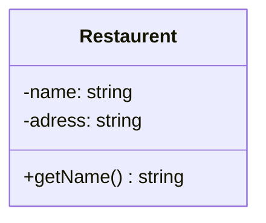
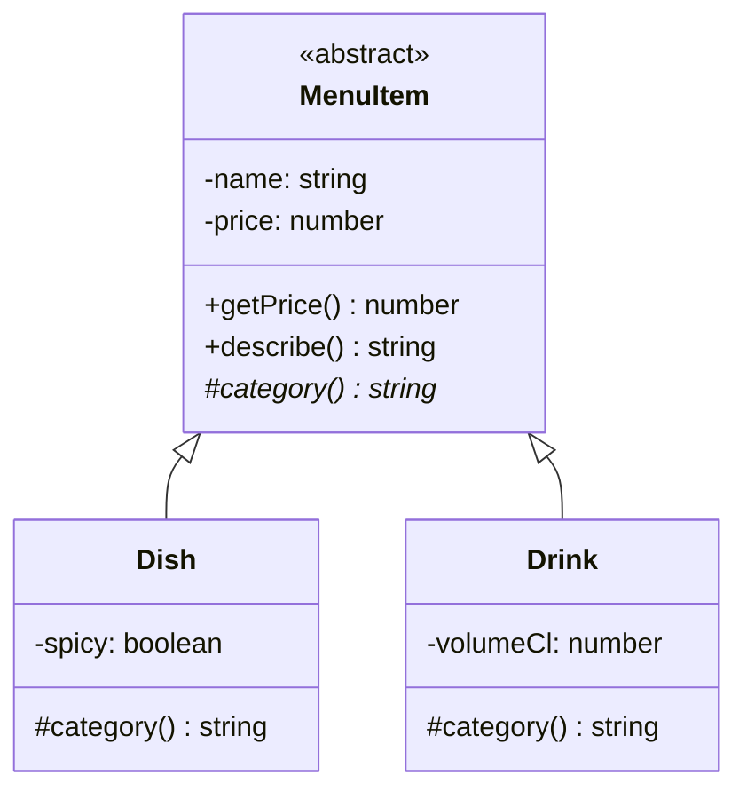
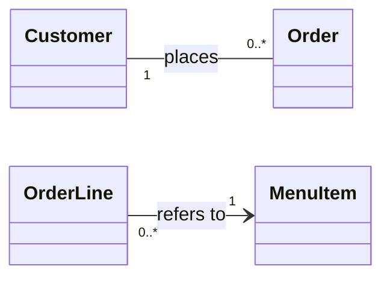
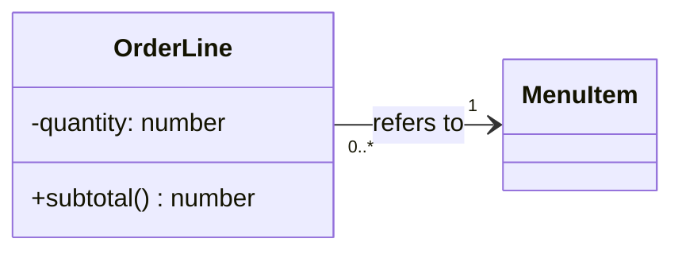
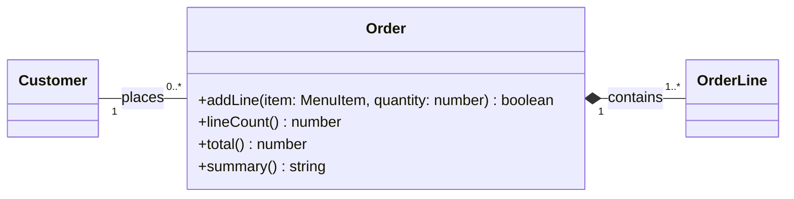
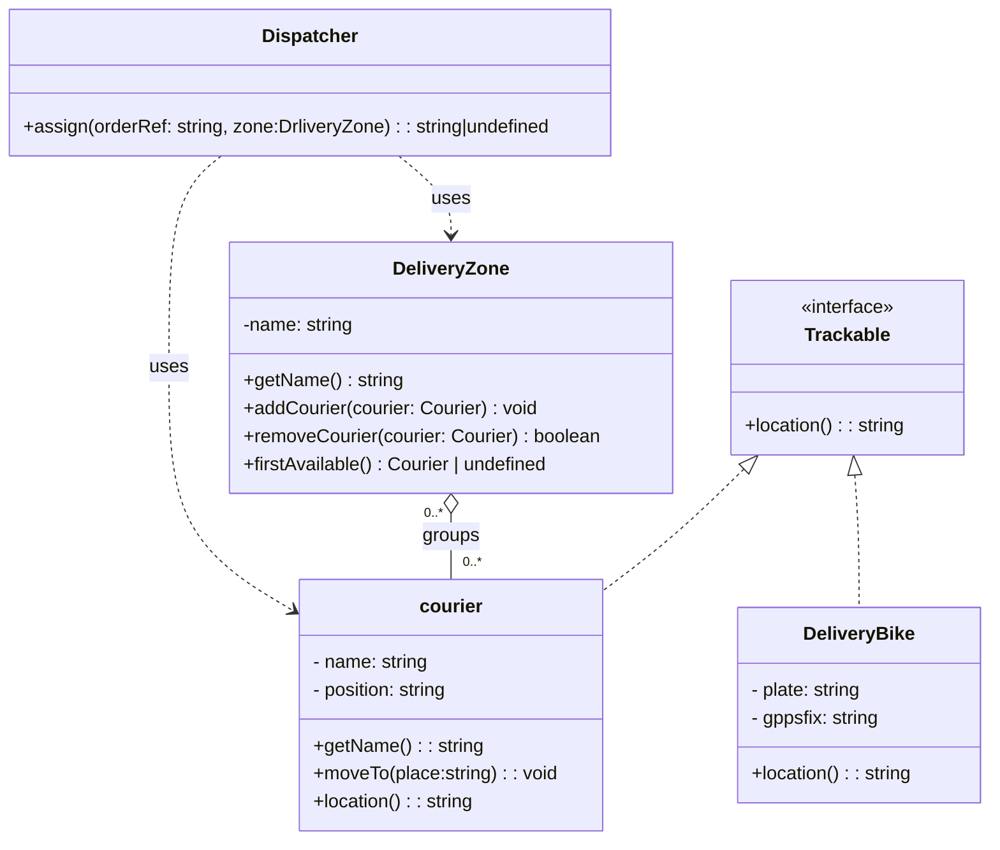

## PART A ##

## Step4 

| Line | Will it be underlined in red? Which symbol in the diagrams of Steps 1 and 3 tells you? | The error message |
|---|---|---|
| (a) | | |Error: Cannot create an instance of an abstract class.
| (b) | | |Error: Property 'category' is protected and only accessible within class 'Dish' and its subclasses.
| (c) | | |Error: Property 'name' is private and only accessible within class 'Customer'.

## Step5

- (a) Can a customer exist without ever having placed an order? yes  0.. at order end
- (b) Can one order belong to two customers? no  1.. at the end of customer
- (c) Can Bissap appear in many order lines? yes 0.. at the end of nenuitems
- (d) Can one order line refer to two menu items? no 1.. at the end of menuitems

## step6

## question2

with only a list of MenuItems, there’s no place to store the quantity. “2 Thieboudienne” would mean adding the same item twice, and the quantity belongs neither to the order nor to the dish, but to one dish in one order.

## step 7

## Question3 
one orderline existe caonnot exist if an order is not create but a menuitem existe on its own and doesn t need an order to exist

## step 8

(a) No, the code isn’t wrong: the association is stored in one direction only, by the customer field in Order
(b) They disagree, because a new order really has 0 lines before addLine(). The fix: change the diagram to Order "1" *-- "0..*" OrderLine.

## PART B diagram##

## Prediction 2: 
Moussa, then undefined Moussa Médina.

## Question 6:
 Dispatcher would need a field that keeps a DeliveryZone

## PART C ##

## Prediction 3:
 6500 5000, then 26500 25000.

 ## step 13

 Before the change: Fatou has Awa's thieb line, 2 × 2500 = 5000.
After the change: that line becomes 10 × 2500 = 25000. Awa's total: 25000 + 1500 = 26500. Fatou's total: 25000

## step 14
 the same line is in two orders, and outside code can change it.

getLines() hands parts out: it returns the real array, so outsiders get the lines themselves.
addExistingLine() takes parts in: it accepts a line the order didn't create, which may belong to another order.

## Step 16
the is-a test fails first: a courier is not a kind of customer. He delivers orders, he doesn't place them. Substitution also fails, since new Order(moussa) would be accepted.
Instead: no triangle. Each class keeps its own name and phone, or both hold a ContactInfo object

## Part D ##

